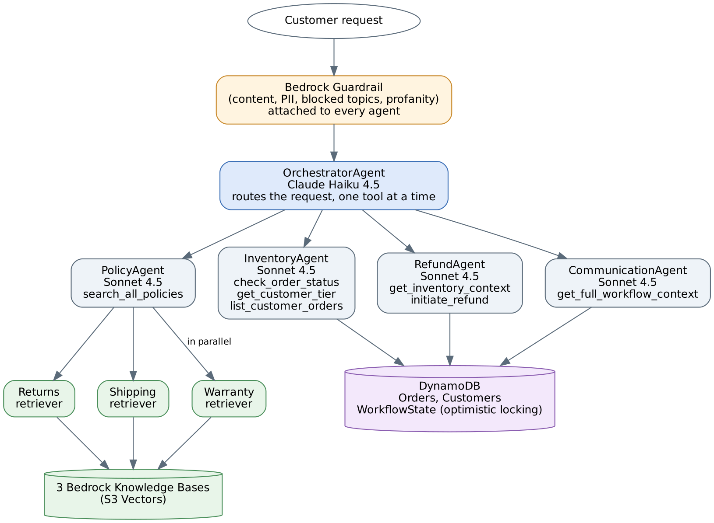

# NovaMart: Multi-Agent Customer Support System on Amazon Bedrock AgentCore

Capstone project of the Udacity **Future AWS Agent Engineer** Nanodegree. A team of AI agents handles customer support for a fictional online retailer, NovaMart: it looks up orders, answers policy questions from knowledge bases, decides and starts returns, and writes the final reply. It runs on **Amazon Bedrock AgentCore** with the **Strands Agents SDK**.

## How a request flows

1. The **Orchestrator** (Claude Haiku 4.5, fast and cheap) never answers the customer. It creates a session record, routes the request to the right workers one tool call at a time, and always ends with the Communication agent.
2. The **worker agents** (Claude Sonnet 4.5) each do one job and save their result in a shared **WorkflowState** row in DynamoDB:
   - **Inventory agent:** reads orders and the customer's tier from DynamoDB. It only reports facts and makes no decisions.
   - **Policy agent:** multi-agent RAG. Three retriever sub-agents (returns, shipping, warranty) query three Bedrock Knowledge Bases **in parallel** with a thread pool, and the Policy agent combines the passages and names the policy each fact came from.
   - **Refund agent:** decides whether an order can be returned (30-day window for Standard customers, 60 days for Premium) and starts the return.
   - **Communication agent:** reads the full WorkflowState and writes the customer's reply.
3. A **Bedrock Guardrail** is attached to every agent, so each model call is filtered.

## What I built

Udacity provided the starter: the AWS clients, the WorkflowState helpers (including the optimistic-locking update), the observability wrapper, the AgentCore CLI helper and the grading script. I implemented the parts below.

- **Five agents with their prompts and tools:** 3 inventory tools, 2 refund tools, the parallel policy search, a communication tool and 5 orchestrator routing tools. Code: [`src/agents.py`](src/agents.py).
- **Bedrock Guardrail:** content filters (sexual, violence, hate, insults, misconduct), profanity, PII handling (card and social security numbers blocked, email and phone anonymized) and three denied topics (competitor comparisons, price haggling, legal threats). Code: [`src/guardrail_memory_observability.py`](src/guardrail_memory_observability.py).
- **AgentCore Memory:** session-summary strategy with 7-day retention.
- **Observability:** CloudWatch logs at INFO level and X-Ray tracing at 100% sampling.
- **Deployment** of the agent graph to an AgentCore Runtime.

## Design decisions I'm proud of

- **The LLM does not get the last word on money.** `initiate_refund` re-checks the return window in code before it changes anything, and it is idempotent: a repeated call returns the same return reference instead of creating a second return.
- **Prompts defend against bad data.** The Refund agent is told to ignore a `return_eligible` flag in the order data and decide only from the customer's tier and the order date. The Communication agent may only quote the refund amount it is given and must never claim an email or text was sent.
- **Routing rules cover the edge cases.** "What is my tier?" goes to the Inventory agent, not the Policy agent, because the policy documents know nothing about the customer. Math questions skip the data agents.
- **Partial failures are visible.** If one knowledge base fails, its retriever returns a `[SOURCE UNAVAILABLE]` marker, and the Policy agent tells the customer the answer may be incomplete instead of guessing.
- **Retrievers are deterministic:** temperature 0, one tool call each, no rewriting of what they retrieve.

## Results

The course grader scored the deployed system **120 out of 120** across six tasks: agent construction and model choice, guardrail, AgentCore Runtime deployment, memory, three knowledge bases and parallel retrieval, and observability. The X-Ray traces show each request going from the Orchestrator through a worker agent to the knowledge base call.

## What's in this repo

| Path | What it is |
|---|---|
| [`src/agents.py`](src/agents.py) | The five agents, prompts, tools and guardrail wiring (excerpt) |
| [`src/guardrail_memory_observability.py`](src/guardrail_memory_observability.py) | Guardrail, memory and observability setup (excerpt) |
| [`docs/architecture.png`](docs/architecture.png) | Architecture diagram |

The code files are excerpts and don't run on their own, because they depend on starter modules that belong to the course. AWS account details and resource IDs are not included.

## Tools

Python, Strands Agents SDK, Amazon Bedrock (Claude Haiku 4.5 and Sonnet 4.5), Bedrock AgentCore (Runtime, Memory), Bedrock Knowledge Bases (S3 Vectors), Bedrock Guardrails, DynamoDB, CloudWatch, X-Ray.
